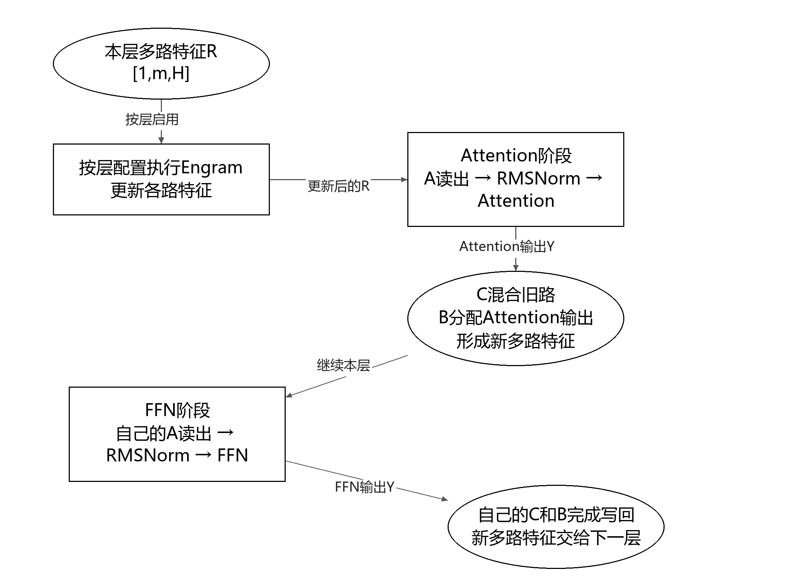
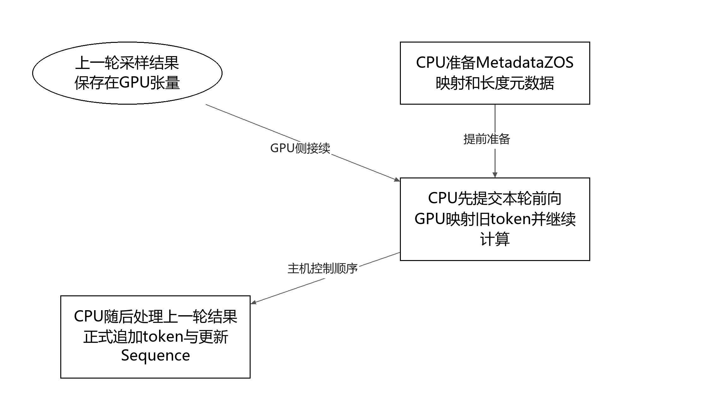

# DeepInfer 中文机制学习笔记

沿一条请求在 DeepInfer 中的执行过程，整理初始化、调度、模型计算、多卡协作、资源管理与效率机制。按 U01–U21、E01–E11 编排，重点记录类之间的协作、关键状态、张量形状与执行顺序。

- **[电子版 Word](docs/DeepInfer机制学习笔记.docx)**：由 25 页手写笔记整理，含重绘图、可编辑公式、目录与修订记录。
- **[手写学习记录 PDF](records/DeepInfer手写学习记录.pdf)**：保留个人学习过程中的推演与记录。

学习案例为 DeepSeek-V4.1-Flash-1017，涉及公开的 GPU 与昇腾 950 执行路径。源码依据为 [官方 DeepInfer 仓库的固定提交 `5537415`](https://github.com/deepseek-ai/DeepInfer/tree/553741557a57df44a46fb3ab72b6aafeaf945337)。

学习与整理过程中使用 AI 辅助讲解、转录和制图。当前内容基于源码研读与机制推演，目标硬件实验后续补充。欢迎通过 Issues 交流与勘误。

## 图示预览

**U15 · 模型层内数据流**：Attention 与 FFN 分别通过 mHC 读出输入、写回多路特征。

**E03 · ZOS 执行衔接**：GPU 接续上一轮结果，CPU 提交本轮计算后再处理上一轮结果。

